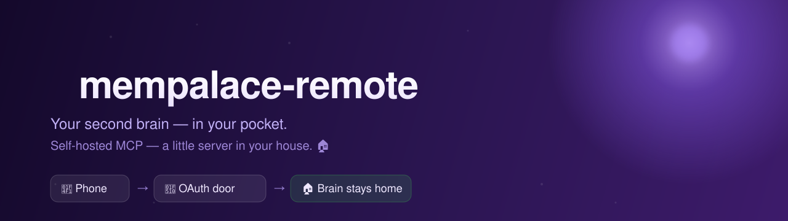

<p align="center">
  
</p>

<h1 align="center">mempalace-remote 🧠📱</h1>

<p align="center">
  <em>A guarded little door that lets any MCP client — the Claude app on your phone,<br>Codex, Cursor, the lot — read your second brain, while the brain itself<br>never leaves the desk it lives on.</em>
</p>

<p align="center">
  
  
  
  
  
  
</p>

<p align="center">
  
  
  
</p>

<p align="center">
  
  <a href="https://github.com/MemPalace/mempalace"></a>
</p>

---

Public **remote MCP** front-end for [**MemPalace**](https://github.com/MemPalace/mempalace)
(the open-source AI memory system), so **any client that speaks remote MCP** —
the Claude app (phone), Codex, Cursor, and the rest — can reach your local palace
as a custom connector. It's plain HTTP MCP + OAuth 2.1, so there's
nothing Claude-specific about it: point any conforming client at the URL. Runs
**entirely on the desktop** — the palace data is stored nowhere else. A Cloudflare
Tunnel (with Cloudflare Access in front) or Tailscale Funnel publishes it; no router
ports, no Hetzner. Just a little server in your house. 🏠

```
📱 claude.ai     → 🔐 Cloudflare Access + Tunnel → 127.0.0.1:8789 (this) → 🧠 mempalace   (cloudflare-access mode)
📱 any MCP client → 🔐 Tailscale Funnel (:443)   → 127.0.0.1:8789 (this) → 🧠 mempalace   (passphrase mode)
```
> The **Claude app** reaches you via Anthropic's servers (`client → ☁️ Anthropic → your URL`),
> so the endpoint must be public. **Codex, Cursor & co.** dial the public URL directly
> (passphrase mode). Either way the brain stays home.

It wraps [MemPalace](https://github.com/MemPalace/mempalace)'s
`mempalace.mcp_server.handle_request` **without changing a line** and
puts a minimal OAuth 2.1 authorization server (metadata + dynamic client
registration + authorization-code + PKCE/S256 + refresh) in front. No third
party — the server is *both* the resource and its own authorizer. The human gate
is one passphrase at the login page. 🚪 Or, in `cloudflare-access` mode, none of
that runs: Cloudflare Access signs you in at the edge and this server only checks
what Access signed.

## Auth modes 🔐

`AUTH_MODE` in the env file picks one. Any other value refuses to start.

| | `passphrase` (default) | `cloudflare-access` |
|---|---|---|
| Who signs you in | this server: OAuth 2.1 + one passphrase | Cloudflare Access (Managed OAuth): your identity provider and its MFA; Cloudflare logs every sign-in |
| Published by | Tailscale Funnel (or any TLS front) | a Cloudflare Tunnel |
| What `/mcp` checks | its own bearer tokens | the `Cf-Access-Jwt-Assertion` Access adds: RS256 signature from the team's keys, `aud`, `iss`, `exp`, and the optional email allowlist |
| Built-in OAuth endpoints | served | gone (404) — there is no login page |
| Clients | any remote-MCP client | only clients whose redirect URI is on the Access allowlist (claude.ai). Local agents use a local MCP server instead, e.g. `http://127.0.0.1:8765/mcp` |
| Extra dependency | none | `pyjwt[crypto]` |

In `cloudflare-access` mode a request without a valid assertion gets
`403 {"error":"forbidden"}` and no `WWW-Authenticate` header: the OAuth challenge
belongs to Access, at the edge. That includes requests that reach the port without
going through Access (the tailnet, localhost). Cloudflare terminates TLS, so it
sees the traffic; the palace itself still lives only on your desk.

## Setup 🚀

> **Requires** a working [MemPalace](https://github.com/MemPalace/mempalace)
> install (the `mempalace` package importable by the interpreter `run.sh` uses).
> This repo is only the public door — the palace itself lives there.

0. **Install** 📦 — the server runs on the interpreter of the `mempalace` uv tool:
   ```bash
   uv tool install mempalace==<version> --with fastapi --with python-multipart --with 'pyjwt[crypto]'
   ```
   `pyjwt[crypto]` is needed only in `cloudflare-access` mode. `uv tool install`
   rebuilds the whole tool environment, so on an existing install pin the mempalace
   version you run and hold every other package where it is:
   ```bash
   uv pip freeze --python ~/.local/share/uv/tools/mempalace/bin/python > before.txt
   uv tool install mempalace==<version> --with fastapi --with python-multipart \
     --with 'pyjwt[crypto]' -c before.txt
   ```

1. **Secrets** 🔑
   ```bash
   mkdir -p ~/.mempalace/remote
   cp env.example ~/.mempalace/remote/env
   chmod 600 ~/.mempalace/remote/env
   # edit ~/.mempalace/remote/env:
   #   passphrase mode        → set MEMPALACE_REMOTE_PASSPHRASE (+ PUBLIC_BASE_URL)
   #   cloudflare-access mode → set AUTH_MODE, CF_ACCESS_TEAM_DOMAIN, CF_ACCESS_AUD
   #                            (+ CF_ACCESS_ALLOWED_EMAILS if you want a second check)
   ```

2. **Run** (foreground test)
   ```bash
   ./run.sh
   ```
   or as a service:
   ```bash
   cp mempalace-remote.service ~/.config/systemd/user/
   systemctl --user daemon-reload
   systemctl --user enable --now mempalace-remote
   sudo loginctl enable-linger ivan   # survive logout/reboot
   ```

3. **Publish** 🌍

   **`cloudflare-access` mode — Cloudflare Tunnel + Access**
   1. Tunnel: add an ingress rule `hostname: mempalace.example.com` →
      `service: http://127.0.0.1:8789`, then
      `cloudflared tunnel route dns <tunnel> mempalace.example.com`.
   2. Zero Trust → Access → Applications → **self-hosted** app on that hostname:
      - policy **Allow** → Emails → you;
      - **Managed OAuth** on (`oauth_configuration.enabled`), with dynamic client
        registration on and `allowed_uris` = `https://claude.ai/api/mcp/auth_callback`
        (localhost and loopback off unless you need them). ⚠️ An empty redirect
        list is the most common connector failure: sign-in ends in a redirect error.
      - copy the app's **Application Audience (AUD) Tag** into `CF_ACCESS_AUD`, and
        the team domain (`https://<team>.cloudflareaccess.com`) into
        `CF_ACCESS_TEAM_DOMAIN`.
   3. Optional, for an outside watchdog: a second self-hosted app on the **path**
      `mempalace.example.com/healthz` with a **Bypass** (Everyone) policy. It shows
      only `ok` or the 503 backend text. Make sure it is the path, not the host:
      an unauthenticated `GET /authorize` must still be answered by Cloudflare
      (`server: cloudflare`, a 401 or a redirect to the Access sign-in), never by
      this server.
   4. Restart; the log says `auth=cloudflare-access team=… aud=…`. From outside,
      an unauthenticated `POST /mcp` gets a 401 from `server: cloudflare`.

   **`passphrase` mode — Tailscale Funnel**
   ```bash
   sudo tailscale funnel --bg 127.0.0.1:8789     # https://<machine>.<tailnet>.ts.net (443)
   sudo tailscale funnel status
   ```
   Funnel can also use 8443 or 10000 (`--https=<port>`); then put the port in
   `PUBLIC_BASE_URL`. If Funnel isn't enabled for the tailnet yet, the command
   prints an admin URL to grant the `funnel` node attribute (run as the tailnet
   owner).

4. **Add the connector** — the URL is your public base URL plus `/mcp`:
   ```
   https://mempalace.example.com/mcp
   ```
   - **Claude app / claude.ai** → Settings → Connectors → Add custom connector
   - **Codex** → add it as a remote MCP server in your config *(passphrase mode)*
   - **Cursor** → Settings → MCP → add server (URL / streamable-HTTP) *(passphrase mode)*
   - **anything else** that supports remote MCP over HTTP → point it here *(passphrase mode)*

   The client discovers OAuth and opens the login page: the passphrase form, or
   the Cloudflare Access sign-in → done. ✅

## Notes 📝
- Calls to mempalace are serialized (ChromaDB + SQLite KG aren't concurrent-safe).
- Passphrase mode keeps OAuth tokens in `~/.mempalace/remote/oauth_state.json`
  (0600). `cloudflare-access` mode neither reads nor writes it, so switching
  back resumes with the clients you had.
- This is **model A (tunnel)**: works while the desktop is awake. The local
  coding-agent auto-save hooks (Claude Code, Codex, Cursor, …) are untouched and
  keep writing the same palace — remote clients just read/write the same brain.
- Backups run hourly (7-day rolling + off-site), and a second always-on box
  watches the public endpoint from the outside — because a machine can't report
  its own death. 🛰️

## Tests 🧪

```bash
uv run --isolated --no-project --with fastapi --with httpx --with python-multipart \
  --with 'pyjwt[crypto]' python -m unittest discover -s tests -v
```

They load `server.py` against a stub palace, a temporary state directory and a
fake network, so they need no MemPalace install and touch no live state. There
is no CI: run them before you push.

---

<p align="center"><sub>The datacenter is a house. One brain, one door, one drawer at a time. 🧠</sub></p>
